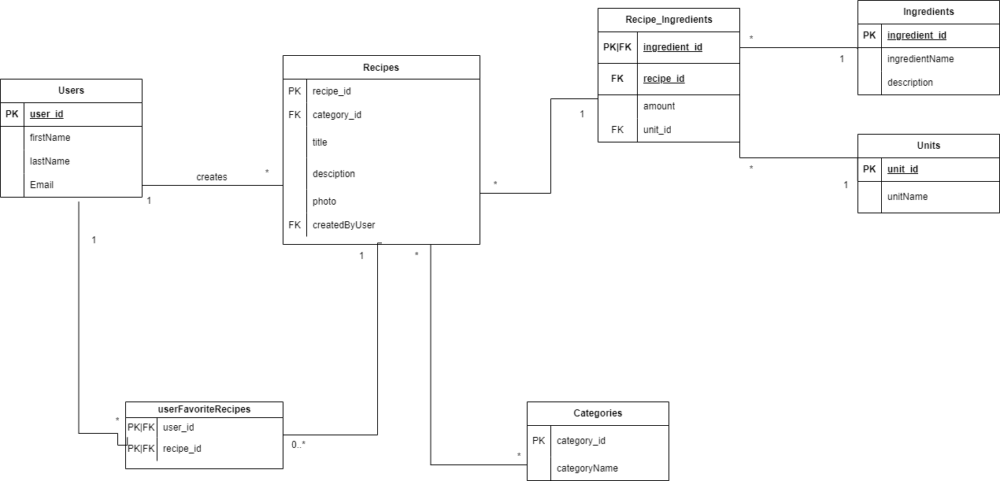

  <video controls playsinline style="width: 100%; max-height: 65vh; border-radius: 12px; box-shadow: 0 4px 20px rgba(0,0,0,0.15); object-fit: contain;">
    <source src="/projects/recipes/demo/demo.mp4" type="video/mp4" />
    Your browser does not support HTML5 video playback.
  </video>

## Introduction & Overview

**Recipes** is a full-stack web application developed for the *Front-end Web Development* and *Web Services* courses at HOGENT (2024–2025). The platform enables users to discover recipes, filter by category and ingredient, manage their own creations and save personal favorites.

The application follows a clean separation of concerns between a **decoupled RESTful API (Node.js + Koa.js + MySQL)** and a **reactive single-page application (React + Chakra UI)**.

---

## Core Features

### 🔑 Authentication & Role-Based Access Control (RBAC)
* **Guest Access**: Browse public recipes and categories.
* **Registered User (`User`)**: Create new recipes, edit owned recipes and save meals to personal favorites.
* **Administrator (`Admin`)**: Full CRUD authority over all users (`GET /api/users`, `GET /api/users/:user_id`), categories, ingredients and recipes.

### 🍲 Recipe Management (CRUD) & Dynamic Forms
* **Recipe Creation & Editing** (`Add_EditRecipe.jsx`, `RecipeForm.jsx`): Dynamic form system built with React Hook Form for managing preparation times, difficulty levels, step-by-step instructions, ingredients and measurements.
* **Search & Filtering** (`RecipeList.jsx`): Instant live search by title or ingredient, with category filtering powered by SWR revalidation.
* **Detailed View** (`RecipeDetailPage.jsx`): Comprehensive view of cooking instructions, scaled ingredient measurements and category tags.

### ⭐ Favorites System
* Persistent storage of saved recipes using `FavoritesContext` connected to the database join table `user_favorite_recipes`.
* Dedicated `FavoritesPage.jsx` for quick access to saved meals.

---

## API Endpoints Structure (REST API)

| Method | Endpoint | Description | Access Level |
| :--- | :--- | :--- | :--- |
| **POST** | `/api/users/login` | Authenticate user & receive JWT token | Public |
| **POST** | `/api/users/register` | Register a new user account | Public |
| **GET** | `/api/users` | Fetch all registered users | Admin |
| **GET** | `/api/users/:user_id` | Fetch specific user details | Admin / Owner |
| **GET** | `/api/recipes` | Fetch all recipes (with filter options) | Public |
| **GET** | `/api/recipes/:id` | Fetch recipe details | Public |
| **POST** | `/api/recipes` | Create a new recipe | User / Admin |
| **PUT** | `/api/recipes/:id` | Update an existing recipe | Owner / Admin |
| **DELETE** | `/api/recipes/:id` | Delete a recipe | Owner / Admin |
| **GET** | `/api/recipes/favorites` | Fetch user favorite recipes | User / Admin |

---

## Tech Stack & Database Schema (ERD)

### Front-end Stack
* **React 18** with **Vite** & **SWC Compiler**: High-performance development workflow and bundled production builds.
* **Chakra UI** (`@chakra-ui/react`, `@chakra-ui/icons`): An accessible, modular and responsive component library.
* **React Router DOM v6**: Client-side routing with `ProtectedRoute` guards enforcing role-based authorization (`Admin` vs `User`).
* **SWR (Stale-While-Revalidate)** & **Axios**: Optimistic UI updates, automatic data revalidation, response caching and custom Axios interceptors for automatic JWT Bearer token injection.
* **React Hook Form**: Form state management with real-time field validation and user feedback.
* **State Management**: Local state via `useState`, global state via `AuthContext` (auth status & user roles) and `FavoritesContext` (user favorites).
* **Cypress**: Automated end-to-end (E2E) integration test suite for core user workflows.

### Back-end & Web Services Stack
* **Node.js** & **Koa.js**: Lightweight, modular web service framework with custom Koa middleware (`@koa/router`, `koa-bodyparser`, `@koa/cors`, `koa-helmet`).
* **MySQL 8** & **Knex.js**: Relational database architecture structured via Knex database migrations and seeders.
* **Argon2 & JWT**: Modern password hashing with Argon2 and stateless session management via JSON Web Tokens.
* **Joi**: Schema-based payload validation for all incoming API endpoints.
* **Winston**: Server-side structured logging and centralized error handling (`ServiceError`).
* **Jest & Supertest**: Unit and integration test suite validating REST API endpoints and error contracts.

### Entity-Relationship Diagram (ERD)

  <video controls playsinline style="width: 100%; max-height: 65vh; border-radius: 12px; box-shadow: 0 4px 20px rgba(0,0,0,0.15); object-fit: contain;">
    <source src="/projects/recipes/demo/demo.mp4" type="video/mp4" />
    Je browser ondersteunt geen HTML5-videoweergave.
  </video>

## Introductie & Projectomschrijving

**Recipes** is een full-stack webapplicatie ontwikkeld in het kader van de opleidingsonderdelen *Front-end Web Development* en *Web Services* aan HOGENT (2024–2025). Het platform stelt gebruikers in staat om recepten te ontdekken, te filteren op categorieën en ingrediënten, bewerkingen uit te voeren en hun persoonlijke favorieten te beheren.

De applicatie is gebouwd met een sterke scheiding tussen een **gekoppelde RESTful API (Node.js + Koa.js + MySQL)** en een **reactieve, component-gebaseerde single-page application (React + Chakra UI)**.

---

## Kernfunctionaliteiten

### 🔑 Authenticatie & Rolgebaseerde Autoriseerbaarheid (RBAC)
* **Gasttoegang**: Bekijken van publieke recepten en categorieën.
* **Ingelogde Gebruiker (`User`)**: Recepten toevoegen, eigen recepten bewerken, en maaltijden opslaan in persoonlijke favorieten.
* **Beheerder (`Admin`)**: Volledige CRUD-rechten over alle gebruikers (`GET /api/users`, `GET /api/users/:user_id`), categorieën, ingrediënten en recepten.

### 🍲 Receptenbeheer (CRUD) & Dynamische Formulieren
* **Recepten Aanmaken & Bewerken** (`Add_EditRecipe.jsx`, `RecipeForm.jsx`): Dynamisch formuliersysteem via React Hook Form waarin bereidingstijd, moeilijkheidsgraad, instructies, ingrediënten en meeteenheden kunnen worden ingevoerd.
* **Zoeken & Filteren** (`RecipeList.jsx`): Instant zoeken op titel of ingrediënten en filteren op categorieën met directe SWR revalidatie.
* **Detailweergave** (`RecipeDetailPage.jsx`): Uitgebreide weergave van kookstappen, geschaalde ingrediëntenhoeveelheden en categorie-badges.

### ⭐ Favorietensysteem
* Persistente opslag van favoriete recepten via `FavoritesContext` en de database koppeltabel `user_favorite_recipes`.
* Toegankelijke overzichtspagina (`FavoritesPage.jsx`) voor het snel raadplegen van bewaarde gerechten.

---

## API Endpoints Structure (REST API)

| Methode | Endpoint | Beschrijving | Toegang |
| :--- | :--- | :--- | :--- |
| **POST** | `/api/users/login` | Inloggen en JWT-token ontvangen | Publiek |
| **POST** | `/api/users/register` | Nieuw account registreren | Publiek |
| **GET** | `/api/users` | Lijst van alle gebruikers ophalen | Admin |
| **GET** | `/api/users/:user_id` | Specifieke gebruiker ophalen | Admin / Eigenaar |
| **GET** | `/api/recipes` | Alle recepten ophalen (met filter opties) | Publiek |
| **GET** | `/api/recipes/:id` | Receptdetails ophalen | Publiek |
| **POST** | `/api/recipes` | Nieuw recept toevoegen | User / Admin |
| **PUT** | `/api/recipes/:id` | Recept bewerken | User (eigenaar) / Admin |
| **DELETE** | `/api/recipes/:id` | Recept verwijderen | User (eigenaar) / Admin |
| **GET** | `/api/recipes/favorites` | Favorieten van ingelogde gebruiker ophalen | User / Admin |

---

## Tech Stack & Databasedesign (ERD)

### Front-end Stack
* **React 18** met **Vite** & **SWC compiler**: Razendsnelle ontwikkeltijd en gebundelde productie-build.
* **Chakra UI** (`@chakra-ui/react`, `@chakra-ui/icons`): Een toegankelijke, modulaire en responsieve UI-componentenbibliotheek.
* **React Router DOM v6**: Client-side routing met `ProtectedRoute` guards die afgeschermde routes beveiligen op basis van rollen (`Admin` vs `User`).
* **SWR (Stale-While-Revalidate)** & **Axios**: Optimistische data fetching, automatische revalidatie, caching en Axios request-interceptors voor automatische JWT Bearer token-injectie.
* **React Hook Form**: Formulierenbeheer met real-time validaties en foutmeldingen.
* **State Management**: Lokale state via `useState`, globale contexten via `AuthContext` (authenticatie/rollen) en `FavoritesContext` (favorietenbeheer).
* **Cypress**: Geautomatiseerde end-to-end (E2E) integratietesten voor kritieke gebruikersflows.

### Back-end & Web Services Stack
* **Node.js** & **Koa.js** framework: Lichtgewicht en krachtige backend met custom Koa-middleware (`@koa/router`, `koa-bodyparser`, `@koa/cors`, `koa-helmet`).
* **MySQL 8** & **Knex.js**: Relationale databank gestructureerd via knex-migraties en seed-data.
* **Argon2 & JWT**: Wachtwoord-hashing op basis van het nieuwste Argon2-algoritme en stateless sessiebeheer via JSON Web Tokens.
* **Joi**: Strikte inputvalidatieschema's voor alle inkomende API-requests.
* **Winston**: Geavanceerde server-side logging en gecentraliseerde foutafhandeling (`ServiceError`).
* **Jest & Supertest**: Unit- en integratietesten voor het valideren van de REST-endpoints.

### Databasedesign (ERD Schema)

